<div align="center">

# Tsuki and the Moon

**A 3D puzzle adventure built in C++ with Unreal Engine 5.8 for Epic Games' AI MegaJam 2026**
*Theme: "Director's Cut"*

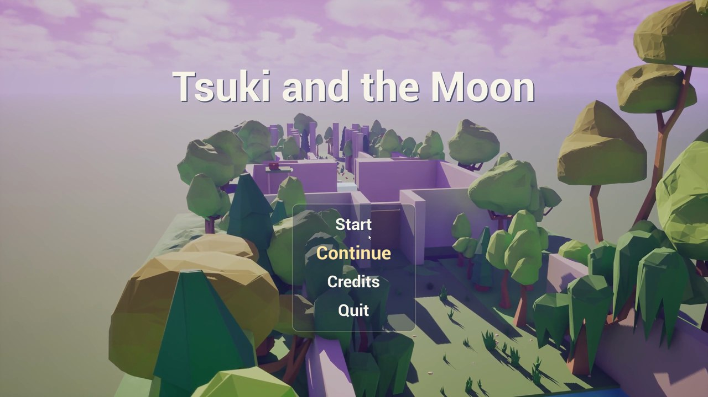

`C++` · `Unreal Engine 5.8` · `UMG / Slate` · `Enhanced Input` · `Unreal Automation` · `Git LFS`

</div>

---

## The game

Tsuki wakes in a quiet forest and finds the **Moon Scissors**, a tool that can **cut a property out of one object and paste it into another**.

Snip the *Lightness* from a feather plant and paste it onto a stone block too heavy to push. Cut the *Heaviness* out of a boulder and splice it into a pebble so it can hold down a pressure plate. Give a crate *Buoyancy*, or put *Slowness* on a platform that moves too fast. Nothing is ever destroyed, only moved, so every puzzle can be re-edited until it works. That's the jam theme taken literally: the player directs the final cut.

| Cut a property… | …paste it somewhere new |
|:---:|:---:|
| 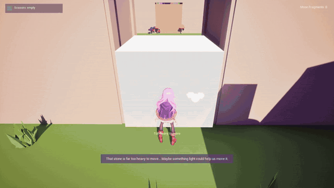 | 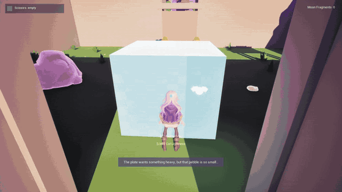 |

The slice spans **three hand-built areas** (Forest Entrance, Sunken Crossing, Whispering Canopy), three tools (Moon Scissors, Moonthread Hook, Moonlit Bombs), hidden Moon Fragments, and a climb up a giant tree toward a shattered moon.

| | | |
|:---:|:---:|:---:|
| 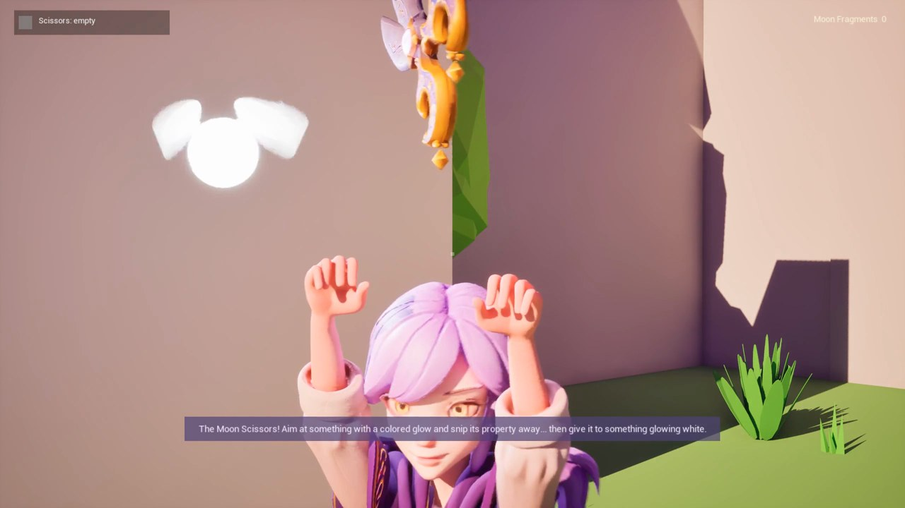 | 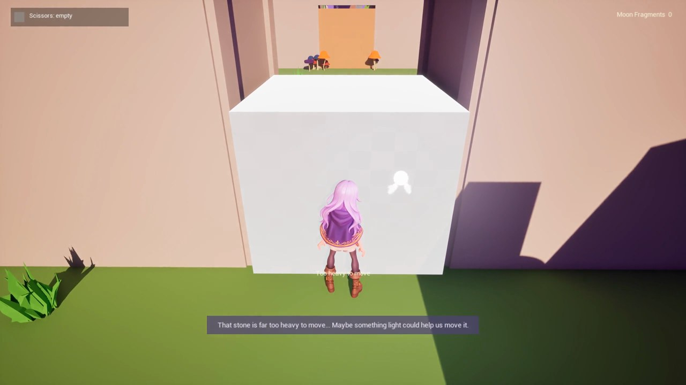 | 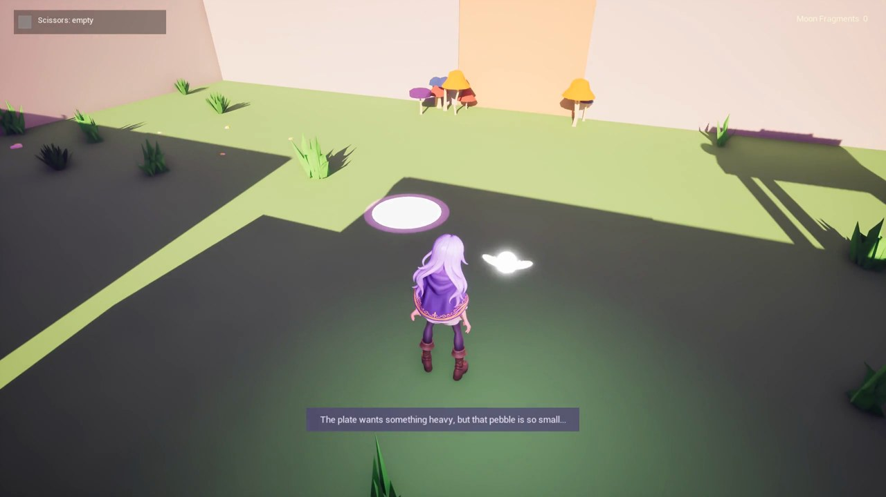 |
| 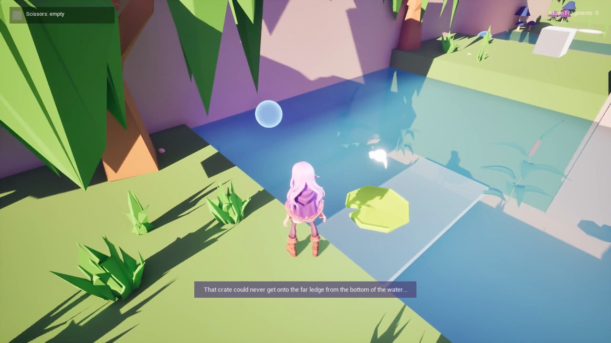 | 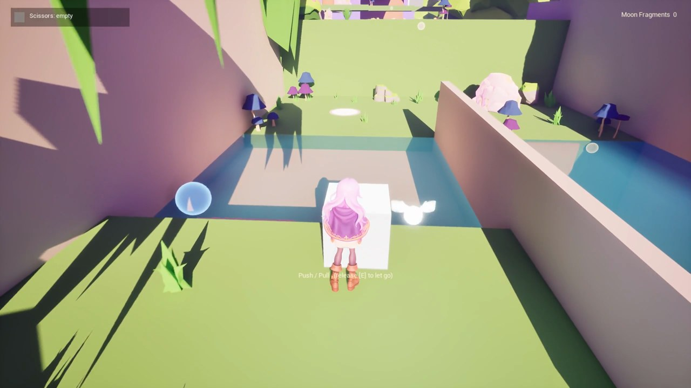 | 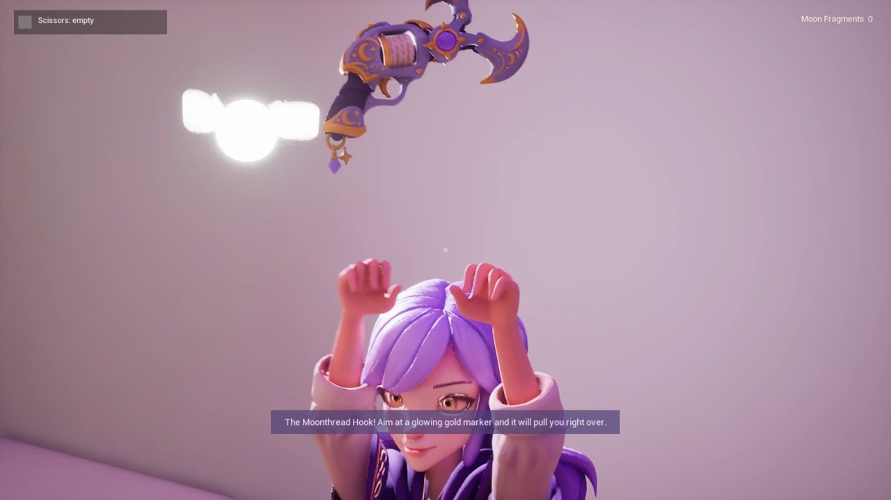 |
| 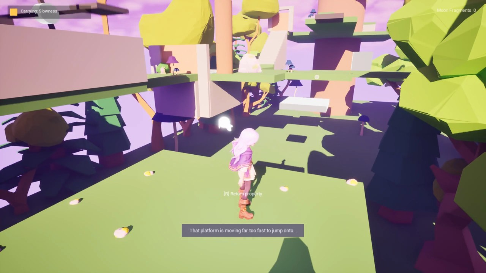 | 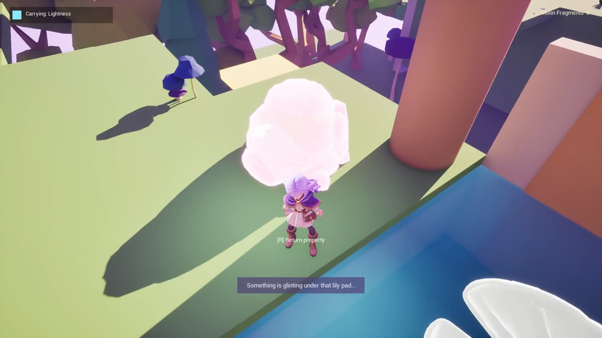 | 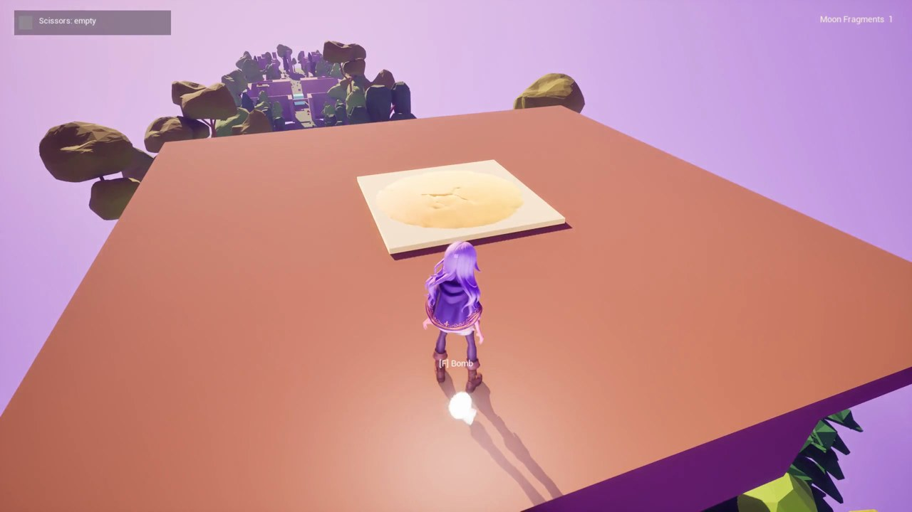 |

---

## Engineering highlights

About **7,700 lines of C++** across 33 source files. Gameplay rules and state live in C++; Blueprints only hold content, tuning and art references.

### Data-driven property system
- **`UPropertyHolderComponent`** can be added to any actor. It tracks which properties the actor holds, which can be cut and which it accepts, and keeps each property's original source so it can be returned.
- **Effective weight** is a pure, static function of base weight and held properties (Lightness ×0.05, Heaviness ×20, the two cancel). Pressure plates, push/pull weight limits and the counterweight lift all read the same number, so puzzles stay consistent by construction.
- **Slowness** maps to per-actor `CustomTimeDilation`, so a slowed platform, wheel or lift runs its own clock without touching global time.
- **Buoyancy** is resolved by `ATsukiPond`, which floats holders to the water line and can lower its own surface when a plate fires.
- All tuning (colours, multipliers, glow intensity) lives in a `UDeveloperSettings` class in `DefaultGame.ini`, not in code.

### Physics-style traversal and interaction
- **Push, pull and carry** (`UGrabComponent`): the held object moves by **swept** collision each tick, objects over the weight limit refuse to move, and the carry runs through lift, hold, lower and throw phases with eased interpolation that follows the midpoint between Tsuki's hand bones.
- **Moonthread Hook** (`UHookComponent`): hold to aim with over-the-shoulder zoom, **ray-to-target aim tolerance**, a straight fire, then an arc pull and mantle onto the anchor's ledge. Misses whiff and retract.
- **Surface swimming** and a smooth, interpolated climb-out at pond edges, plus timed hook sequences, moving and rotating platforms, and a weight-driven counterweight lift.

### Animation in C++
- **`UTsukiAnimInstance`** plays looping states and one-shots as dynamic montages, so the AnimGraph is a single slot.
- It keeps root-motion clips in place by **offsetting the mesh against hip drift** and pins a retargeted skeleton's root scale every frame, so Mixamo and retargeted clips play cleanly on a non-standard skeleton.

### Rendering and presentation
- A stylized **master material** with per-asset material instances (base colour, normal, roughness, metallic and emissive, plus saturation and tint).
- A per-object **property glow** driven by **custom primitive data**, so one overlay material shows every property colour without extra material instances.
- **Dusk lighting** built by tuning the sky atmosphere's Rayleigh scattering, sun angle and colour, sky light and height-fog inscattering.
- A **title screen written entirely in C++/UMG** (no widget asset), with a spline-orbit flyover camera, fades, a new-game confirmation and shared keyboard, mouse and gamepad selection.

### Systems and tooling
- **Save/load** through a `UGameInstanceSubsystem`: tools, Moon Fragments, solved puzzles and the active checkpoint are written on every change, and Continue resumes at the last checkpoint.
- **Unreal automation tests** cover the weight formula and the full cut → attach → return transfer loop (`Tsuki.Properties.*`).
- **Level instances** for each area inside one persistent world, with Git LFS for binary assets.

### Built with AI agents
This was an **AI MegaJam** entry. I directed AI coding agents (Claude Code connected to the editor through Unreal's MCP toolsets) to write and iterate on C++, place and tune level content, and verify features in Play-In-Editor. I set the design, made the calls on scope and feel, playtested, and produced the art pipeline (AI-generated meshes, Mixamo rigging and retargeting).

---

## Code map

```
Source/Tsuki_and_the_Moon/
├── Properties/   Property enum, holder component, settings, property actor
├── Player/       Character, scissors, grab/carry, hook, bombs, anim instance
├── World/        Plates, gates, ponds, platforms, lift, chests, fairy guide, ending, title camera
├── Core/         Game modes (gameplay + title), progress/save subsystem
├── UI/           HUD, title menu widget
└── Tests/        Unreal automation tests
```

## Controls

| Action | Keyboard and mouse |
|---|---|
| Move / camera / jump | WASD / mouse / Space |
| Cut or attach a property (throw while carrying) | Left mouse |
| Interact, open, grab, push and pull, pick up and put down | E |
| Return a property to its source | R |
| Aim the Moonthread Hook | Hold right mouse |
| Moonlit Bomb | F |
| Fairy hint | Q |
| Recenter camera | Middle mouse |

## Building

1. Install **Unreal Engine 5.8** and Visual Studio 2022 with the C++ game development workload.
2. Clone with Git LFS (`git lfs install`, then `git clone`).
3. Right-click `Tsuki_and_the_Moon.uproject` → **Generate Visual Studio project files**, then open the project and let it compile.
4. Open `Content/Tsuki/Maps/L_Title` and press **Play**. Packaged builds start on the title screen.
5. Run the tests from **Tools → Session Frontend → Automation**, filter `Tsuki`.

## Credits

- Design, direction and programming: **Angus**
- Music: "Path of Adventure" by **Kounine**, licensed under [CC BY 4.0](https://creativecommons.org/licenses/by/4.0/)
- Sound effects: Pixabay and Freesound contributors
- Environment art: Low Poly Nature Asset Pack by **Naranjo Studios**
- Made with **Unreal Engine**
